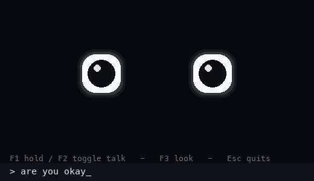

# Rocky

A desk companion built around a local voice clone, a local brain, a local
vision model, and a pair of animated eyes.

Talk to him, type to him, show him things. Nothing leaves the machine unless
you explicitly configure a hosted brain or a cloud voice.



## Status

| Piece | State |
|---|---|
| Voice clone (XTTS v2, Rocky) | Working, but **too slow for real-time** (~2.4–3.8 s per clause on an M1 Max) |
| Mic → speech-to-text (faster-whisper) | Working, ~0.4 s after release |
| Brain (Ollama `qwen3-coder:latest`, streaming) | Working, ~0.1 s warm first token |
| Sentence/Clause pipelining | Working, speech starts on the first completed clause |
| Eyes, 7 emotions, white sclera + black pupil | Working |
| Webcam look (F3) + local vision | Working, `qwen2.5vl:3b` |
| macOS camera + mic permission | Working **only via a real `.app` bundle** |
| GUI text input | Working |
| Barge-in / echo cancellation / streaming playback | **Not implemented yet** |

The current app is turn-based. The real-time redesign is documented in
[`docs/REALTIME_PLAN.md`](docs/REALTIME_PLAN.md); the measured bottlenecks are in
[`docs/LATENCY.md`](docs/LATENCY.md).

## Quick start (macOS, Apple Silicon)

```sh
# 1. Python 3.11 (TTS caps at <3.12)
brew install python@3.11 ffmpeg

# 2. Dependencies
./setup.sh

# 3. Voice assets (not redistributed here; see assets/README.md)
./scripts/restore_assets.sh /path/to/your/rocky-assets

# 4. Local models
ollama pull qwen3-coder
ollama pull qwen2.5vl:3b

# 5. Voice server (first load ~20 s)
COQUI_TOS_AGREED=1 ./venv/bin/python rocky_say.py --server start

# 6. Build and launch the app bundle
./scripts/make_app.sh
open -n ./Rocky.app
```

Run from the project instead of the bundle if you do not need the camera:

```sh
./venv/bin/python rocky_desktop_app.py
```

## Controls

```
F1 hold / F2 toggle   talk (release F1 to send)
F3 or Space           look through the camera
type + Enter          talk by keyboard
1 – 7                 force an emotion (when the input line is empty)
Esc                   quit
```

## How it works

```
mic ──► faster-whisper ──► qwen3-coder (Ollama, streamed)
                                   │
                                   ▼
                         sentence / clause split
                                   │
                                   ▼
                         XTTS v2 voice clone ──► pygame playback
                                   │
                                   ▼
                          eyes react to amplitude

camera ──► one JPEG ──► qwen2.5vl:3b (Ollama) ──► one spoken sentence
```

The app is deliberately local-first: no API keys are required. Hosted
OpenAI-compatible or Anthropic brains are supported via CLI flags.

## Documentation

| Document | What |
|---|---|
| [`HANDOFF.md`](HANDOFF.md) | Current agent handoff: state, constraints, phases, next action |
| [`PROJECT.md`](PROJECT.md) | The full project handbook: setup, architecture, configuration, performance, gotchas, roadmap, licensing |
| [`docs/ARCHITECTURE.md`](docs/ARCHITECTURE.md) | Component and threading model |
| [`docs/SETUP.md`](docs/SETUP.md) | Detailed install, permissions, assets, and app bundle |
| [`docs/LATENCY.md`](docs/LATENCY.md) | Measured latency and how to reproduce it |
| [`docs/REALTIME_PLAN.md`](docs/REALTIME_PLAN.md) | Research-backed plan for sub-second speech, barge-in, and continuous vision |
| [`docs/RESEARCH.md`](docs/RESEARCH.md) | Verified sources, model comparison, and caveats |
| [`docs/ROADMAP.md`](docs/ROADMAP.md) | Phased implementation plan |
| [`docs/TROUBLESHOOTING.md`](docs/TROUBLESHOOTING.md) | Camera, audio, Ollama, TTS, and packaging fixes |
| [`docs/GUIDE.md`](docs/GUIDE.md) | Upstream voice-script guide (grammar transform, RVC, etc.) |
| [`docs/HANDOFF-2026-10-21.md`](docs/HANDOFF-2026-10-21.md) | Original build handoff, preserved for history |

## Project layout

```text
.
├── rocky_desktop_app.py   # the desktop app: mic, STT, brain, vision, TTS, eyes, UI
├── rocky_eyes.py          # emotion presets, renderer, --selftest
├── rocky_say.py           # voice script + persistent XTTS server
├── app.py                 # older browser UI (port 8765), not the primary path
├── setup.sh               # Python 3.11 venv + dependencies
├── scripts/
│   ├── restore_assets.sh  # copy voice assets from your private backup
│   └── make_app.sh        # build the macOS .app bundle
├── assets/                # voice assets live here (not committed)
├── shots/                 # rendered eye / app reference images
└── docs/                  # architecture, setup, latency, research, roadmap
```

## Privacy

- Default brain and vision run through local Ollama at `127.0.0.1:11434`.
- The camera opens only for an explicit look in the current implementation.
- The planned always-on perception mode keeps detection local and sends frames
  to a VLM only on demand; see the plan.
- Logs are written to `~/Library/Logs/Rocky.log` (bundle) or `$TMPDIR/rocky-desk.log`.

## License and attribution

This project is a derivative of
[`Kuberwastaken/rocky-tts`](https://github.com/Kuberwastaken/rocky-tts) and is
released under **CC BY-NC 4.0**. The Rocky character and voice are the
intellectual property of the *Project Hail Mary* film production; the voice
assets are for personal, non-commercial use only and are **not** included in
this repository. See [`LICENSE`](LICENSE) and [`NOTICE.md`](NOTICE.md).

Do not use this project or its voice assets commercially.
